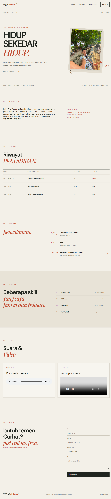

# Laporan Singkat Pembuatan Website Portofolio

**Nama:** Tegar Aldiano Kurniawan

**NIM:** 312510058

**Project:** Website Portofolio Pribadi  

**Teknologi:** HTML5 dan CSS3

## 1. Tujuan Pembuatan
Website ini dibuat sebagai media untuk memperkenalkan diri dan menampilkan informasi pribadi dalam satu halaman website. Informasi yang ditampilkan meliputi profil singkat, pendidikan, pengalaman kerja, keahlian, media audio-video, dan kontak.

## 2. Proses Pembuatan
1. **Menyiapkan bahan dan informasi.** Mengumpulkan data profil, riwayat pendidikan, pengalaman kerja, keahlian, foto, serta informasi kontak yang akan ditampilkan.
2. **Membuat struktur HTML.** Menyusun halaman menggunakan HTML5, seperti bagian header, navigasi, beranda, tentang saya, pendidikan, pengalaman, keahlian, media, kontak, dan footer.
3. **Mengatur tampilan dengan CSS.** Membuat desain dengan nuansa warna krem dan aksen merah bata, mengatur jenis dan ukuran huruf, jarak, tata letak, serta tampilan foto dan formulir.
4. **Menambahkan media dan navigasi.** Menyediakan elemen audio dan video serta tautan navigasi menuju bagian-bagian halaman.
5. **Melakukan pemeriksaan tampilan.** Membuka halaman untuk melihat susunan konten dan memastikan file HTML terhubung dengan file CSS.

## 3. Hasil Pembuatan
Website berhasil disusun menjadi portofolio satu halaman dengan navigasi ke beberapa bagian. Desain menggunakan layout sederhana bergaya editorial dan memiliki aturan responsif untuk layar yang lebih kecil.

### Screenshot hasil website

![Screenshot hasil website portofolio]

## 4. Struktur File
```text
portfolio_tegar/
├── index.html
├── style.css
├── README.md
├── Screenshot_Hasil_Portofolio_Tegar.png
├── images/
│   ├── profil.jpeg
│   └── profil.svg
└── media/
    ├── Audio.mp3
    └── Video.mp4
```

## 5. Cara Menjalankan
1. Simpan seluruh file dalam satu folder sesuai struktur di atas.
2. Pastikan file CSS bernama `style.css` dan berada bersama `index.html`.
3. Letakkan foto di folder `images` serta file audio dan video di folder `media` dengan nama yang sesuai.
4. Buka folder menggunakan Visual Studio Code.
5. Jalankan `index.html` melalui Live Server atau buka langsung menggunakan browser.

## 6. Catatan
File HTML saat ini memanggil `media/Audio.mp3` dan `media/Video.mp4`. File media tersebut perlu disediakan dan dimasukkan ke folder `media` agar dapat diputar. Formulir kontak masih berupa contoh dengan validasi HTML dan belum terhubung ke server, sehingga belum mengirim pesan secara langsung.

## 7. Kesimpulan
Proses pembuatan website dilakukan dengan menyusun struktur halaman menggunakan HTML5, kemudian mengatur desain menggunakan CSS3.Hasil akhirnya adalah website portofolio yang menampilkan informasi pribadi dalam beberapa bagian dan dapat dibuka melalui browser.
